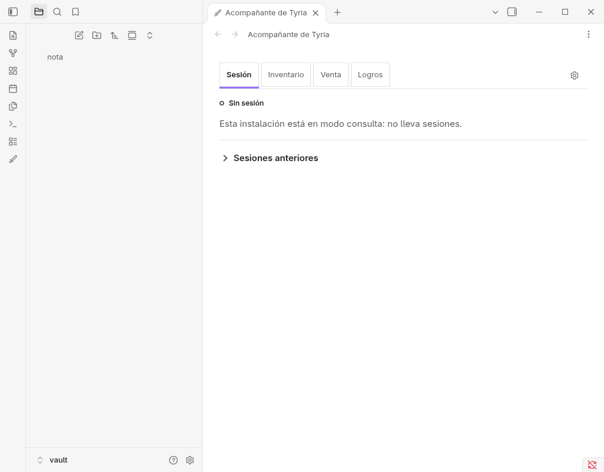

# Candidato 0.6.46 en hosts reales desechables, 11 oct 2026

Máquina: Fedora 44 (Linux 7.2.9). Candidato medido: `3d4a653f` (atestación del candidato), empaquetado con
`npm run release:package` desde una copia plana de `git archive`. Es anterior a los arreglos del tercer audit (A-1,
A-2, B-1, C-1, C-2, D-1, D-2): esta evidencia no los cubre. Hosts: Hebra rpm `0.2.0-22` y Obsidian 1.14.4 AppImage,
los dos desechables, con perfil, datos y bus propios. El Hebra y el Obsidian de David no se tocaron.

Marcas: MEDIDO = observado ejecutándolo; LEÍDO = dicho por el código o un fichero; INFERIDO = deducido, no observado.

## Resultado

| Tarea | Host | Resultado | Clase |
|---|---|---|---|
| HP-03, la sección Sesión pinta | Hebra 0.2.0-22 Linux | PASA | MEDIDO |
| RT-09 nivel 2 | Hebra 0.2.0-22 Linux | PASA | MEDIDO |
| HP-01, urgencia y silencio del aviso | Hebra 0.2.0-22 Linux | PARCIAL | MEDIDO (comando), no medido (plugin) |
| RT-09 nivel 2 contra la Hebra de David | Hebra real de David, solo lectura | `carga=loaded (activada 0.6.42)` | MEDIDO |
| RT-17 en modo consulta | Obsidian 1.14.4 | PASA | MEDIDO |

## Hebra 0.2.0-22 desechable

Montaje: bus D-Bus privado, `XDG_*` propios, `systemd-run` con `MemoryMax=3G`, inspector solo en `127.0.0.1`. Plugins de
terceros y registro de diagnóstico activados a mano en el `localStorage` del propio Hebra desechable. Sin cuenta, sin
clave API y sin sync. Los tres ficheros del plugin salen de `release:package` (`hebra-main.mjs`, `hebra-styles.css`,
`hebra.json`).

**HP-03, MEDIDO: PASA.** La sección Sesión pinta «Sin sesión · modo consulta · Sesiones anteriores», con el bloque
`.tyrian-live-session` presente. Cero `TrustedHTML` en el registro de Tyrian y en `diagnostico.jsonl`. Inventario, Venta
y Logros pintan como antes; Logros dice «Cargando el catálogo» en el momento de leerlo. El único `global_error` es
`secrets.load` (no hay servicio de secretos en el bus privado): artefacto del montaje, no del plugin.

**RT-09 nivel 2, MEDIDO: PASA.** Con el registro encendido y `--diagnostics-file`, `verify-hebra-install` da
`PASS (version=0.6.46; release-bytes=not-checked; carga=loaded (activada 0.6.46))`. Sin el registro encendido da
`carga=no-data (path-unknown; ...)`, que el script presenta como aviso y no como prueba de que no cargara.
`release-bytes` no se comprobó porque la release 0.6.46 aún no existe.

**HP-01, PARCIAL.**

- MEDIDO: el comando de avisos de Hebra (`notify_system_linux`), invocado con la entrada que el plugin construye
  (urgencia crítica y silencio), pone en el `Notify` de D-Bus el hint `"urgency"` con byte 2 y `"suppress-sound"` en
  true. Se midió con `dbus-monitor` en un bus privado, sin servicio de notificaciones real: el `Notify` llegó al bus,
  la respuesta fue `ServiceUnknown`, como se esperaba.
- LEÍDO: `hebraSystemNotifyInput` (`src/host/hebra/hebra-host.ts`) construye esa entrada; `has('notify.urgency')` es
  true en `capabilities.ts` de Hebra. No se midió desde el plugin.
- NO MEDIDO: un aviso disparado por el propio plugin. No se encontró en el candidato un aviso de prueba sin cuenta; en
  modo consulta `dispatchAlert` no actúa (LEÍDO). Tampoco se probaron otros caminos de aviso.
- NO MEDIDO: que GNOME enseñe el aviso encima de GW2 a pantalla completa.

## Hebra real de David, solo lectura

`verify-hebra-install` en nivel 2 contra el registro de diagnóstico de la Hebra 0.2.0-22 de David dio
`carga=loaded (activada 0.6.42)`: esa Hebra tenía instalada la 0.6.42, no el candidato, así que prueba que el
verificador funciona contra un registro real, no que la 0.6.46 cargue. No se escribió nada en esa Hebra.

## Obsidian 1.14.4 AppImage desechable, RT-17 en modo consulta

Montaje: AppImage oficial fuera de flatpak, `systemd-run` con `MemoryMax=3G`, `env -i`, `XDG_RUNTIME_DIR` propio, D-Bus
desactivado, perfil y bóveda propios. El modo consulta es el de una bóveda sin clave API (LEÍDO: la semilla es
`consult` con `apiKeySecret` vacío; MEDIDO: el panel dice «modo consulta: no lleva sesiones»). El almacén se silencia
como en la medición con la 0.6.45: una transacción `versionchange` v2 a v3 que se mantiene viva, y después
`disablePlugin` y `enablePlugin` por CDP.

**Error de sesión, MEDIDO.** Con el almacén mudo, «Sin sesión» de 0 a ~10 s y «Error de sesión» a +10,41, +10,38 y
+10,30 s (tres corridas), sin avisos. Encaja con `STORAGE_ANSWER_TIMEOUT_MS` de 10 s (LEÍDO).

**Recuperación sola, MEDIDO: PASA.** Soltado el bloqueo, el panel vuelve a «Sin sesión» sin recargar el plugin:

| Bloqueo soltado a (desde `enablePlugin`) | Sale de «Error de sesión» a | Tras soltar |
|---|---|---|
| 28,1 s | 35,0 s | 7,0 s |
| 50,2 s | 65,0 s | 15,0 s |
| 100,2 s | 115,0 s | 14,0 s |

La 0.6.45 en la misma máquina no se recuperó en 166 s. Los tiempos encajan con los reintentos a 5, 10, 20 y 40 s con
lecturas de 10 s (LEÍDO, `session-store-retry.ts`). Peor caso observado: 15 s tras soltar; el tope teórico entre
reintentos es de 5 min (LEÍDO). Capturas: 

**`verify-beta-runtime`, MEDIDO.** PASS antes, después de la recuperación y tras cerrar (SIGTERM) y reabrir, con
`--no-release-check` porque la release 0.6.46 no existe todavía (`gh release view` = not found); `release-bytes` no se
comprobó. El plugin cargó a la primera, sin modal de confianza (`community-plugins.json` escrito de antemano). Las
bases de sesión v2 y de colector v1 quedaron intactas.

## Aislamiento, MEDIDO

El socket del CLI del Obsidian de David tuvo el mismo inodo y la misma fecha antes, después de cada lanzamiento y cierre
y al final; un vigilante cada 0,5 s no disparó. El Obsidian y el Hebra de David siguieron vivos, con la misma hora de
inicio. Los procesos propios se cerraron por el PID guardado y los perfiles, bóvedas y la copia del repo se borraron.
No se escribió en ningún repo.

## Qué no se midió

- BRAT real ni una release publicada: nada se instaló desde BRAT.
- RT-17 en modo recolector, con una sesión viva o con el almacén mudo más de 5 min.
- Un aviso del propio plugin (HP-01) ni GNOME sobre GW2 a pantalla completa.
- macOS, Windows y móvil.
- Los arreglos del tercer audit: el candidato medido (`3d4a653f`) es anterior a todos.
