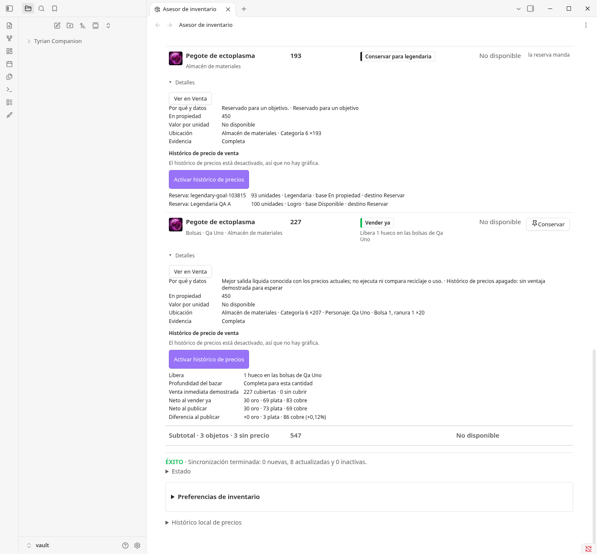
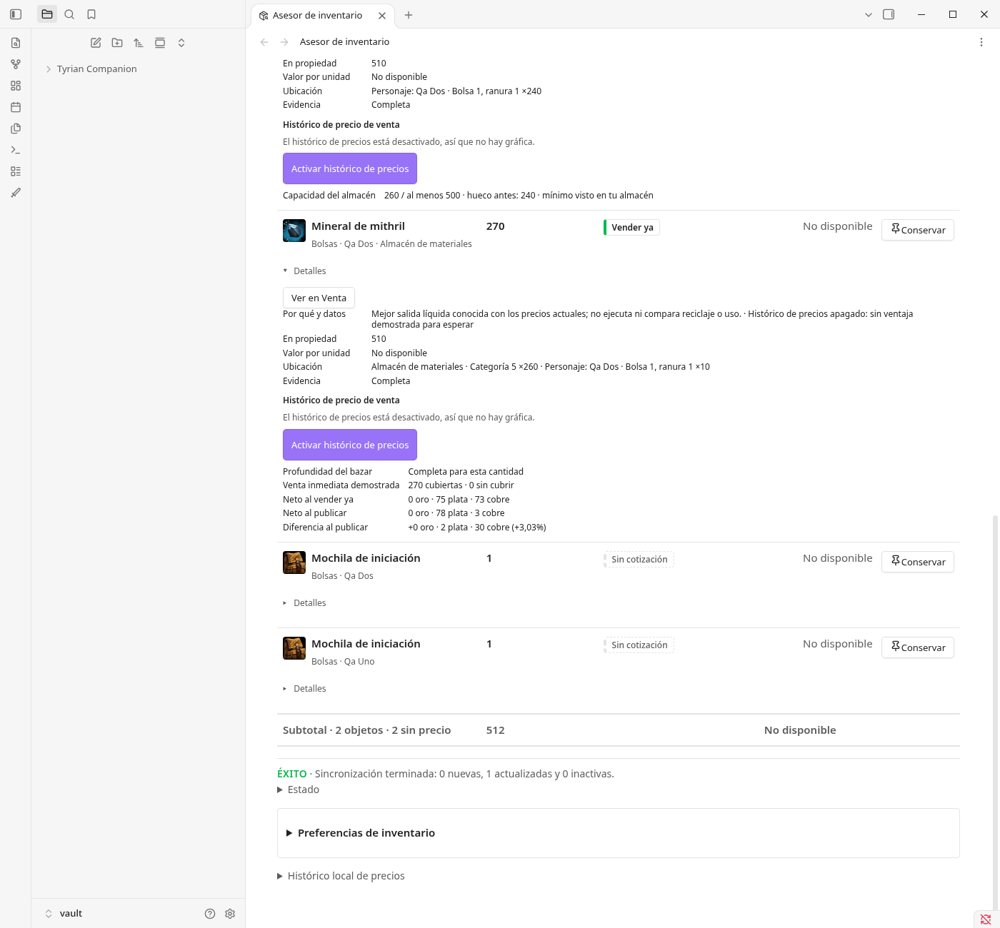
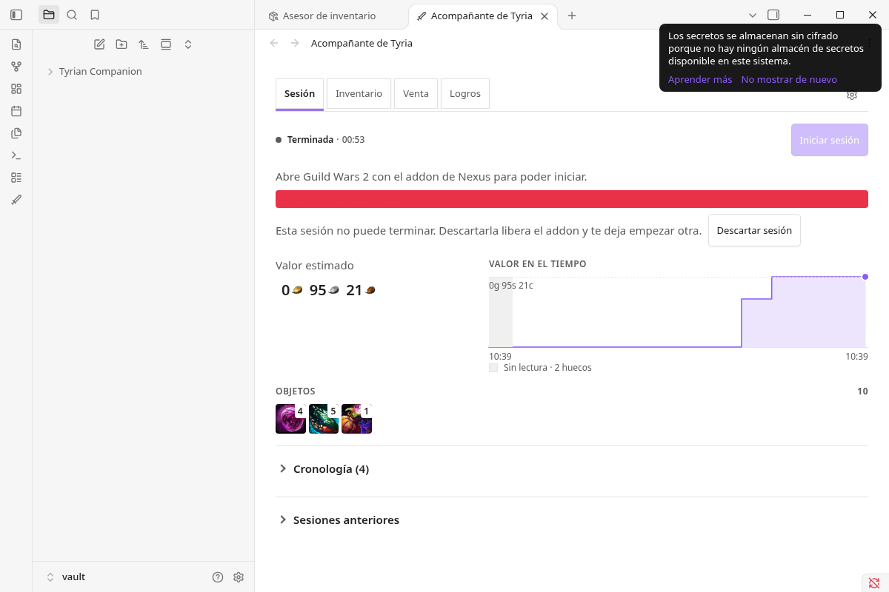
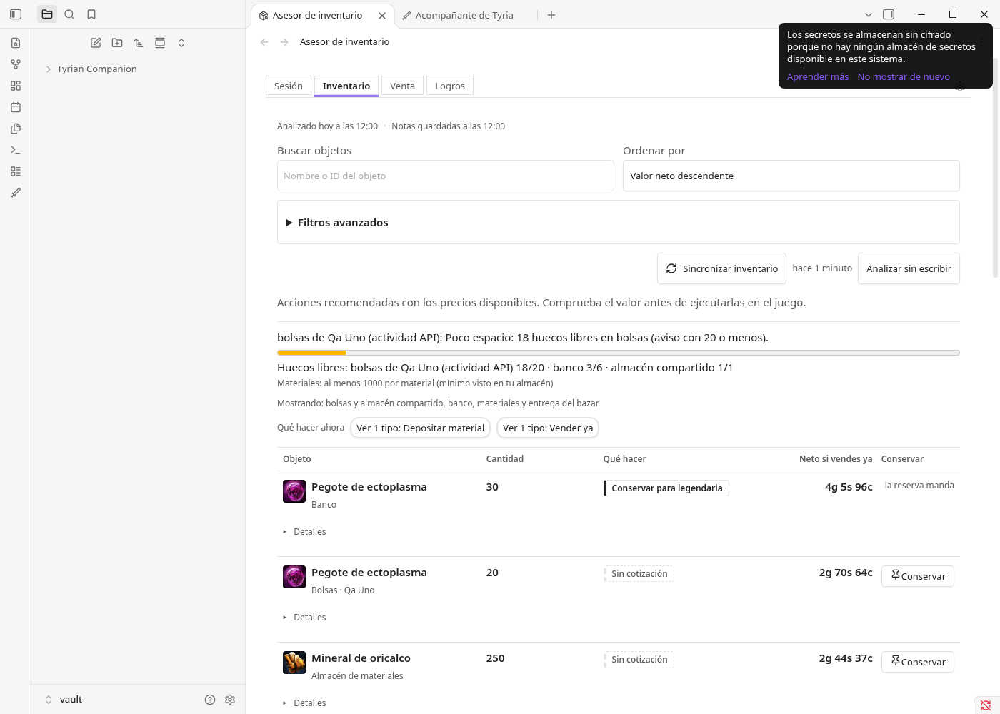
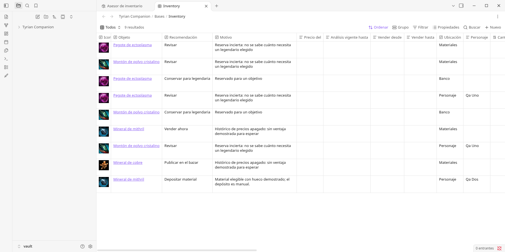
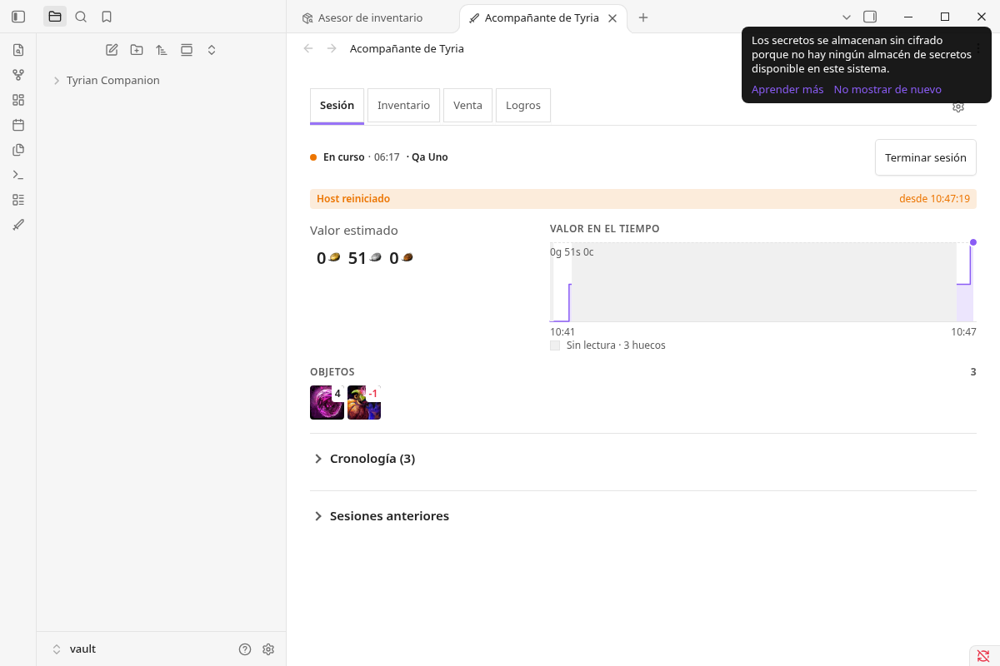
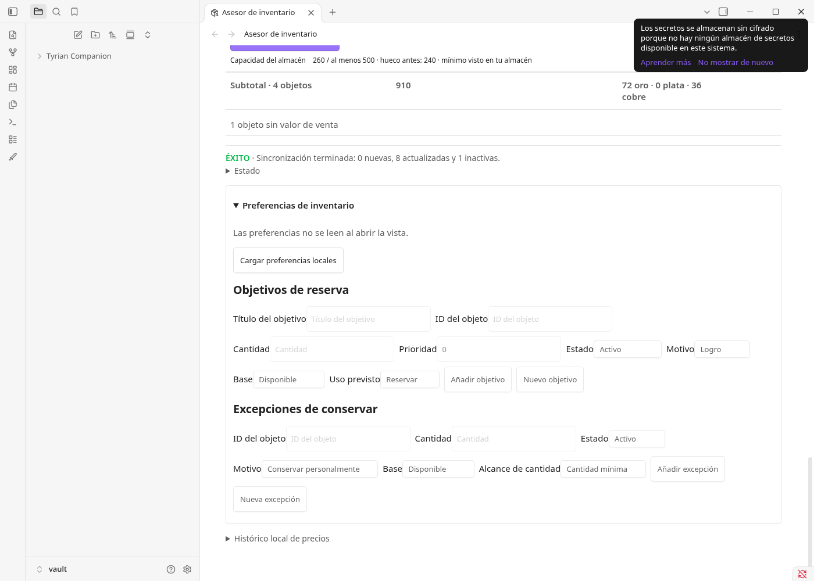
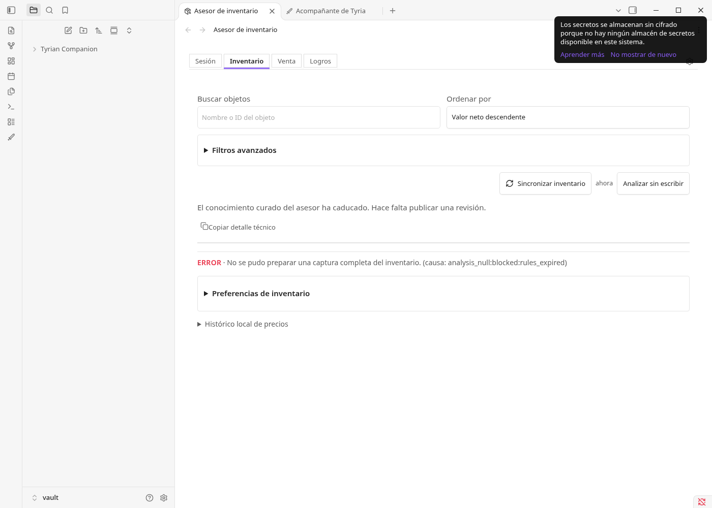

# H18.29 · QA de año normal (pruebas 1 a 10) sobre la 0.6.47, Obsidian AppImage, 11 oct 2026

Candidato: `0.6.47` construido en un worktree en `026a4d5d5558` (= `origin/main`, «attest the 0.6.47
release candidate»). Máquina: Fedora 44 (Linux 7.2.9-200.fc44.x86_64), Node v22.23.1. Matriz:
[QA-MVP](../QA-MVP.md), pruebas 1 a 10 (anexo B). Método de aislamiento: el de
[2026-10-11-obsidian-appimage](2026-10-11-obsidian-appimage.md).

Marcas: MEDIDO = observado en la instancia real; LEÍDO = leído en código o documentación;
INFERIDO = deducido, no observado. Clases: **A** = ejecutable aquí sin Guild Wars 2 ni cuenta real
(con la API y el addon simulados que se describen abajo); **B** = necesita el juego, la cuenta real, el
sistema operativo real o una herramienta mayor.

## Resumen

| Prueba | Clase | Resultado | Fallos |
|---|---|---|---|
| 1 Reservas | A (paso 1 sin UI) | **FAIL** | F1 (la parte libre de un objeto reservado sale «sin valor de venta»), F2 («Legendarias objetivo · Cargar lista» falla siempre) |
| 2 Precios | A parcial | PASS parcial; precio hundido en ventana NO EJECUTADO (B) | Observaciones O2, O3 |
| 3 Fallos del cierre | adaptada a sesión Nexus; A el fallo de escritura, B el resto | **FAIL** (texto) | F4 (la UI ofrece solo «Descartar sesión» aunque el cierre se reintenta solo) |
| 4 Suspensión | adaptada; A aproximada (SIGSTOP), B suspensión real | PASS (aproximación) | — |
| 5 Sesión año normal | adaptada; A | PASS (sesión Nexus de 63 min sin fin falso); calidad y comparación N/A en v1 | — |
| 6 Rearme | adaptada; A | PASS | — |
| 7 Atribución | B (obsoleta para la sesión v1) | NO EJECUTADO | — |
| 8 Inventario sin espacio | A (paso 2 sin UI) | PASS de lógica; **FAIL** de guía/UI | F1, F3 (no hay control de capacidad en Ajustes) |
| 9 Resincronizar | A | **PASS** | O1 (doc desactualizada) |
| 10 Fronteras de fecha | A con reloj desplazado | **FAIL** | F5 (la tabla de legendarias no caduca), F6 (todo el mercado pasa a «La regla está obsoleta» el 25 feb 2027) |

## Entorno y herramientas

- **Build** (MEDIDO): `npm ci` y `node esbuild.config.mjs production` bajo
  `systemd-run --user --scope -p MemoryMax=2G`. El `tsc --noEmit` de `npm run build` murió por memoria
  (OOM de V8) con ese tope de 2 GiB, así que solo se generó el bundle; el gate atestado del candidato
  ya lo cubre. `main.js` sha256 `d99ee51b69095f209b1f825ab877a222fdaeeafb388c4b4e67663bc39cd786d9`,
  `manifest.json` `9c5fc9f0…b3a1`, `styles.css` `dbbab93d…120e`, instalados por copia en la bóveda.
  No se ejecutó la suite, `npm run check` ni el gate.
- **Obsidian** (MEDIDO): AppImage 1.14.4 (sha256 `6362ddbe…eaa`, igual al digest de GitHub), extraído,
  lanzado con `env -i`, `HOME`/`XDG_*` propios, `XDG_RUNTIME_DIR=/tmp/claude-1000/tq7` (enlace corto),
  `DBUS_SESSION_BUS_ADDRESS=disabled:`, `--user-data-dir` propio, `--remote-debugging-port=9334` y
  `--ozone-platform=headless` (sin ventana en el escritorio de David). Catorce arranques (`tcq-run1`…`14`),
  cada uno en su scope con `MemoryMax=2G`. Bóveda y perfil desechables nuevos; clave API ficticia
  `FAKE-QA-KEY-NOT-REAL-0000` en el SecretStorage desechable.
- **API simulada** (plugin de QA `tc-qa-fake`, 107 líneas, solo en la bóveda desechable, no en el repo):
  se carga antes que Tyrian, captura la asignación `app.plugins.plugins["tyrian-companion"]` y envuelve
  `core.host.http.request`. Las rutas **autenticadas** de `api.guildwars2.com` (tokeninfo, account,
  characters, inventarios, banco, materiales, cartera, delivery, transacciones) responden desde una
  cuenta fija; ninguna sale a la red. Las **públicas** (items, prices, listings, legendaryarmory,
  datawars2) van a la red real sin clave. Opciones: subir precios/órdenes, quitar un precio (206),
  aplanar el histórico de datawars2 de un objeto y desplazar el reloj del renderer.
- **Addon Nexus simulado** (`nexus-sim.mjs`, 66 líneas, fuera del repo): cliente TCP del puente
  `live1` v3 (hello con el token creado en Ajustes, context, heartbeat cada 4 s, `live_open`, línea base
  y una muestra cada 2 s). Puerto **47899**: el 47823 lo usa el Hebra de David (MEDIDO con `ss -ltnp`,
  pid de `hebra`), así que el script se niega a usar 47823 y el listener 47899 se comprobó en el cgroup
  del scope de QA antes de conectar.
- **Reloj** para la prueba 10: el plugin de QA sustituye `Date` en el renderer antes de que cargue Tyrian.
  El proceso principal (TLS, `requestUrl`) sigue con el reloj real. Las cachés escritas el 11 oct quedan
  viejas en la fecha simulada, como le pasaría a una instalación que lleva meses abierta.

Las dos herramientas rondan el límite de ~100 líneas del encargo; se usaron porque sin ellas ninguna de
las diez pruebas pasa de clase B.

## Fallos

### F1 · Una fila «Vender ya» con valor demostrado sale «No disponible» y va a «sin valor de venta»

Pasos (MEDIDO, pruebas 1 y 8): cuenta con 450 ectoplasmas (20 en bolsas, 30 en banco, 400 en materiales);
objetivo de reserva manual de 100 y legendaria Klobjarne Geirr (123). Sincronizar inventario.

- Esperado: la parte libre (227) aparece como «Vender ya» con su valor, separada de la reservada.
- Obtenido: las notas están bien (`19721-m-account`: reservado 193, libre 207), pero en el Asesor las filas
  «Pegote de ectoplasma 227 · Vender ya», «193 · Conservar para legendaria» y las equivalentes del polvo
  cristalino tienen «Valor por unidad: No disponible» y quedan dentro del desplegable cerrado «3 objetos
  sin valor de venta». El subtotal principal no las cuenta. En la misma tarjeta, «Profundidad del bazar»
  dice «Neto al vender ya 30 oro · 69 plata · 83 cobre». Captura:
  
- Otra forma (prueba 8): 250 de mithril en bolsas con hueco de 240 en el almacén se parte en «Depositar 240»
  y «Vender ya 270»; las dos salen «No disponible». Con 10+5 en dos pilas también.
  
- Causa (LEÍDO): `src/inventory/inventory-analysis.ts:362-376` deja `valuationByDecision` en `null` cuando
  una posición de nota está repartida en más de un tramo o el tramo no cubre la posición entera; la
  presentación lo convierte en `unavailable` (`src/advisor/inventory-advisor-presentation.ts:141-145`) y la
  vista lo manda al grupo sin valor (`src/ui/inventory-advisor-view.ts:896-899`). Pasa siempre que hay
  reserva parcial, depósito parcial o varias pilas: los casos normales de las pruebas 1 y 8.

### F2 · «Legendarias objetivo · Cargar lista» falla siempre contra la API real

Pasos (MEDIDO): Ajustes → Tyrian Companion → Legendarias objetivo → «Cargar lista» (dos veces).
Esperado: lista de legendarias para elegir. Obtenido: «No se pudo cargar la lista. Inténtalo de nuevo.»
La petición `GET /v2/legendaryarmory` (pública, red real, sin tocar por el simulador) responde 200.
Causa (LEÍDO + MEDIDO): `src/runtime/tyrian-companion-core.ts:998-1005` exige objetos con `id`, pero
`/v2/legendaryarmory` sin `?ids=all` devuelve un array de números (`[101582, 83162, …]`, comprobado con
`curl`). Consecuencia: el paso 1 de la prueba 1 no se puede hacer desde la interfaz y tampoco se ve la marca
de tabla caducada (`tableStale`) que la prueba 10 pide. Para seguir se escribió
`legendaryTargetItemIds` con `core.updateSettings` (equivale a editar `data.json`).

### F3 · La capacidad de materiales ya no se puede configurar desde Ajustes (prueba 8, paso 2)

MEDIDO: no hay ningún control de capacidad en Ajustes. LEÍDO: la fila se retiró en `00ddcaf6`
(6 oct, «one page with a closed Maintenance block»); el ajuste sigue vivo en `data.json`. La guía de la
prueba 8 pide configurarla «en Ajustes». O se recupera el control o se reescribe la prueba.

### F4 · Un cierre que falla al escribir solo ofrece «Descartar sesión», aunque se reintenta solo

Pasos (MEDIDO, prueba 3 adaptada): sesión Nexus con 4 cambios; `chmod 555` a `sessions/2026` y
`summaries`; «Terminar sesión».
- Obtenido: cabecera «● Terminada · 00:53», una barra roja sin texto legible (el DOM contiene «No se pudo
  terminar la sesión») y «Esta sesión no puede terminar. Descartarla libera el addon y te deja empezar
  otra.» con un único botón, **Descartar sesión**. No hay «Reintentar».
  
- Al devolver los permisos, el plugin escribió la nota solo, en menos de 20 s, y el aviso desapareció: una
  sola nota (`2026-10-11 103904Z - bd3865128222d64d.md`, sha256 `56a82e74…6b9b`) y un solo resumen. El
  registro tiene dos `session_finish` · `storage_failure` · `live_note_write`.
- Riesgo: quien siga la interfaz descarta una sesión que se habría guardado. Texto en
  `src/ui/live-session-copy.ts:89`, decisión en `src/ui/live-session-control.ts:69` y
  `src/ui/live-session-panel.ts:564-580`.

### F5 · La tabla de legendarias no caduca el 10 dic 2026

Pasos (MEDIDO, prueba 10): objetivo Klobjarne Geirr; reloj del renderer a 2026-12-09T12:00Z, sincronizar;
reiniciar con 2026-12-10T00:00:30Z, sincronizar.
Esperado: desde el 10 dic a las 00:00 UTC, tabla marcada caducada y materiales en «reserva incierta».
Obtenido: las mismas reservas exactas los dos días (ecto 193+30, polvo 90+10 «Conservar para
legendaria»), sin ningún aviso de caducidad. Causa (LEÍDO): `src/runtime/tyrian-companion-core.ts:1206`
devuelve siempre `LEGENDARY_MATERIALS_TABLE` sin mirar `validUntil` (`2026-12-10T00:00:00.000Z`,
`src/economy/legendary-materials.ts:401`). El único uso de esa fecha es `tableStale` en la lista de Ajustes
(línea 1019), que no carga (F2). Contradice lo que documenta `src/inventory/inventory-analysis.ts:169-172`.

### F6 · El 25 feb 2027 todo el mercado pasa a «Revisar · La regla está obsoleta»

Pasos (MEDIDO): reloj a 2027-02-24T23:59Z, sincronizar (razones normales); reiniciar con
2027-02-25T00:00:30Z, sincronizar: 7 de 11 posiciones (ectoplasma, polvo, minerales de cobre, mithril y
oricalco) pasan a `review` · `rule_stale` («Sin cotización · La regla está obsoleta»). El 31 may 2027 sigue
igual. Esperado (prueba 10): el 31 may 2027 la regla de 300 días y el conocimiento curado siguen vigentes.

Causa (LEÍDO; la frontera medida coincide): la política de reciclaje de equipo vence el
`2027-02-25T00:00:00.000Z` (`src/economy/models/equipment-salvage-policy.ts:13`).
`evaluateEquipmentSalvageEconomy` valida esa ventana en `isInput` (`src/economy/equipment-salvage-economy.ts:240-241`)
**antes** de descartar el objeto como no aplicable, y responde `policy_invalid_or_stale` también para
materiales que no son equipo. El clasificador lo traduce a `rule_stale`
(`src/advisor/inventory-advisor-classifier.ts:472`). La tarjeta del mineral de cobre muestra la sección
«Economía de reciclaje de equipo».

## Observaciones (no son fallo confirmado)

- **O1** · `docs/INVENTORY-VAULT-SYNC.md:32-36` dice que un plan que desactiva filas se detiene en «Confirmar
  cambios antes de escribir». MEDIDO: quitar un objeto de la cuenta y sincronizar escribe «0 nuevas, 8
  actualizadas y 1 inactivas» sin pausa. Es la decisión H18.37 (`src/ui/inventory-vault-sync-run-controller.ts:219-221`):
  la documentación está desactualizada.
- **O2** · Si `/v2/commerce/prices` y `/listings` responden 206 sin un objeto tradeable que tienes, la
  sincronización entera falla («La revisión de inventario no es válida… (causa: discard_input_shape)»), en
  vez de dejar ese objeto como «precio desconocido». Provocado con el simulador; no consta que la API
  real lo haga con un objeto tradeable.
- **O3** · Una serie plana con la puja de hoy 1 c por debajo (oricalco: histórico 116 c, puja 115 c) sale
  «Esperar · Precio por debajo de la parte alta de su historial» (percentil 1). Con la puja igual a la serie
  (cobre, 21 c) sale «Publicar en el bazar · Sin ventaja demostrada para esperar». En ningún caso sale como
  oportunidad excepcional.
- **O4** · El día a medias: datawars2 devuelve hoy (2026-10-11) como fila más. La gráfica lo pinta como
  «Último · 0g 0s 21c · 2026-10-11», sin marcarlo como parcial; el análisis usa 2026-10-10
  (`tc_price_history_last_day`). No se descarta en silencio, pero tampoco se distingue de un día completo.
- **O5** · Tras «Terminar sesión», el host corta la época del addon (`error unexpected_message`) y las
  reconexiones siguientes reciben `live_ready status:"source_conflict"` hasta que se pulsa «Iniciar
  sesión». Es intencionado: `blocksAutomaticRestart` en `src/runtime/alert-runtime.ts:520`. Pero el addon
  ve un «conflicto de fuente» que no lo es.
- **O6** · Desde el 1 jun 2027 el Asesor dice «El conocimiento curado del asesor ha caducado. Hace falta
  publicar una revisión.» (correcto), pero la sincronización falla con «No se pudo preparar una captura
  completa del inventario (causa: analysis_null:blocked:rules_expired)». Las notas se quedan como
  estaban y el Asesor no enseña el inventario.
- Fallos provocados por el simulador y descartados: subir la puja 3-7 c a todos los objetos cruzaba el libro
  (puja por encima de la venta, imposible en el bazar real) en objetos sin órdenes de compra (79673, 79677 y
  79679 tienen puja 0) y la revisión salía inválida. Subir solo la oferta de venta o la puja de los objetos
  propios funciona.

## Prueba por prueba

Versión probada en todas: **0.6.47**, `026a4d5d5558`, main.js `d99ee51b…86d9`, Obsidian 1.14.4 AppImage,
Fedora 44.

### Prueba 1 · Reservas

| Paso | Clase | Resultado | Evidencia |
|---|---|---|---|
| 1 Objetivo de legendaria en Ajustes | A | **FAIL** (F2); se fijó Klobjarne Geirr (103815) por `data.json` | «No se pudo cargar la lista» |
| 2 Segundo objetivo sobre el mismo material | A | PASS | Preferencias de inventario → «Legendaria QA A · 19721 · 100»; ecto reservado 223 = 123 + 100, sin duplicar |
| 3 Objetivo sin tabla curada | A (por `data.json`, F2) | PASS | Legendaria 30698 sin entrada: ecto y polvo `review` · `reservation_uncertain`, reservado y libre `null`.  |
| 4 Sincronizar | A | PASS en notas; **FAIL** en el Asesor (F1) | `19721-m-account.md` 193 reservado / 207 libre (sha256 `6972b235…16e3`); banco 30 «Conservar para legendaria» (fuera de venta); reparto banco + materiales = 30 + 193 |

### Prueba 2 · Precios

| Paso | Clase | Resultado | Evidencia |
|---|---|---|---|
| 1 Histórico activado y un día de captura | A (la siembra de datawars2 sustituye la espera de un día) | PASS | 36038: `tc_price_quoted_at 2026-10-11T10:25:44Z` frente a `tc_price_history_last_day 2026-10-10`; espera cuantificada (ventaja −148 c, rango −266…478, 7 temporadas, 6 perdidas) |
| 2 Sin precio de hoy | A parcial | PASS (histórico); O2 (precio vivo ausente) | El día en curso no entra en el análisis |
| 3a Serie plana | A (serie aplanada por el simulador) | PASS | Cobre: «Publicar en el bazar · Sin ventaja demostrada para esperar»; O3 |
| 3b Precio hundido en la ventana del saco | B | NO EJECUTADO | Requiere la ventana del festival y su histórico; con el reloj desplazado el histórico queda dos meses caducado |
| 4 Panel de historial | A | PASS | Gráfica con Máximo, Mínimo y Último fechados, «Fuente: datawars2 (tercero)» |
| Día a medias | A | PARCIAL (O4) | «Último · 2026-10-11» sin marca de parcial |

### Prueba 3 · Fallos del cierre (adaptada a la sesión Nexus)

Las sesiones por API ya no existen: `getSessionSource` es siempre `nexus_inventory`
(`src/runtime/tyrian-companion-core.ts:3454`). Con la sesión Nexus en curso (MEDIDO),
`arm-assisted-detection` da `checkCallback(true) = false` y solo `finish-farming-session` da `true`.

| Paso | Clase | Resultado | Evidencia |
|---|---|---|---|
| 1-2 Red cortada antes de la captura final y reintento | B / obsoleto | NO EJECUTADO | El cierre de la sesión Nexus no captura por red |
| 3 Fallo al escribir la nota | A | Escritura **PASS** (una sola nota); interfaz **FAIL** (F4) | `bd3865128222d64d`, sha256 `56a82e74…6b9b` |
| 4 Segunda ventana sobre la misma bóveda | B | NO EJECUTADO | Obsidian no abre la misma bóveda dos veces en una instancia; dos instancias usan perfiles con IndexedDB y `navigator.locks` separados. Hace falta otro diseño de prueba |
| Camino `error` por pérdida de coordinación | B | NO EJECUTADO | — |

### Prueba 4 · Suspensión (adaptada)

| Paso | Clase | Resultado | Evidencia |
|---|---|---|---|
| 1-2 Suspender más de 5 min y reactivar | A aproximada; B la suspensión real | PASS (aproximación) | `SIGSTOP` a todo el scope de 10:41:21 a 10:46:49 (5 min 28 s). Al volver: «En curso 05:47 · Conexión perdida desde 10:41:21»; el addon reconecta (`live_ready ready`) y la sesión sigue (06:07). `SIGSTOP` no es una suspensión del sistema: el reloj monótono avanza |
| 3 Cerrar Obsidian con la sesión activa y reabrir | A | PASS | `SIGTERM` y relanzamiento: «En curso 06:17 · Host reiniciado desde 10:47:19», valor conservado.  |
| 4 Terminar e iniciar otra sin «Limpiar» | A | PASS | Nota `acf4cb59151b8f10` guardada; «Iniciar sesión» abre otra sesión (con el addon conectado; O5) |

### Prueba 5 · Sesión año normal (adaptada)

La detección asistida y las calidades `exact`/`estimated` son de las sesiones por API, que ya no existen.
Se ejecutó el equivalente v1: una sesión Nexus de una hora en un mapa normal.

| Paso | Clase | Resultado | Evidencia |
|---|---|---|---|
| 1-2 Sesión en un mapa que no es el 866, sin sacos, al menos 60 min | A (addon simulado, mapa 15) | PASS | De 10:56:40 a 12:00:14 (1:03:33), una muestra cada 2 s; cada 3 min +1 ecto y +2 polvo, y desde el minuto 30 un objeto sin precio (46731). Sin fin falso: «En curso 1:03:28» al final; el simulador no recibió ningún error |
| 3 Terminar a mano | A | PASS | `sessions/2026/2026-10-11 105640Z - e04e47824fd68a8a.md` (sha256 `58cb755b…35d9e`): 43 cambios, 3813 s con objetos observados |
| 4 Historial, total y comparación | A | PASS parcial; el resto N/A | La nota da «Subtotal neto conocido de objetos: 60120 c», «Valor neto estimado completo: —» y «Objetos sin precio: Montón de polvo de hematites (46731)»: no lo llama ganancia total. «Sesiones anteriores» lista cada sesión con su duración y valor, pero no tiene total agregado, ni recuento de sesiones sin valorar, ni comparación por calidad (eso era de las sesiones por API). La sesión recién terminada se queda arriba como «Terminada» y no pasa a la lista hasta que empieza otra |

### Prueba 6 · Dos sesiones con detección rearmada (adaptada)

| Paso | Clase | Resultado | Evidencia |
|---|---|---|---|
| 1 Completar una sesión | A | PASS | Notas `abf3775540b77027`, `bd3865128222d64d` y `acf4cb59151b8f10` |
| 2 Segunda sesión sin «Comprobar conexión» | A | PASS | La sesión arranca sola con la primera presencia del addon tras abrir el host (MEDIDO tres veces); tras un «Terminar» manual basta pulsar «Iniciar sesión» (O5). La detección asistida por API ya no existe |

### Prueba 7 · Atribución

B y obsoleta para la sesión v1. La sesión Nexus observa solo «bolsas del personaje controlado» (resumen
de la nota). Traslados A→B, compras y ventas en el bazar, mercader y entregas no tienen las razones
`tp_buy_observed`, `tp_sell_observed`, `wallet_decreased` ni `delivery_items_changed` en el modelo live:
una disminución es «causa desconocida» (SPEC-live-loot). Rehacerla pide el juego o una prueba nueva
sobre el modelo live. NO EJECUTADO.

### Prueba 8 · Inventario sin espacio

| Paso | Clase | Resultado | Evidencia |
|---|---|---|---|
| 1 Sin capacidad, más de 250 de un material | A | PASS | 400 ecto en el almacén: «Materiales: al menos 500 por material (mínimo visto en tu almacén)»; mithril «260 / al menos 500 · hueco antes: 240»; «Depositar material» no se bloquea.  |
| 2 Capacidad explícita | A sin UI (F3) | PASS de lógica | `materialStorageCapacity 500` por `data.json`: «500 por material (configurada)»; 300 de mithril en bolsas → «Depositar 240» = hueco; resto «Vender ya 270» (F1) |
| Evidencia en `Bases/Inventory.base` vista «Materiales» | — | N/A | La Base no tiene columnas de capacidad: el mínimo visto solo sale en el Asesor (la guía pide algo que no existe) |

### Prueba 9 · Resincronizar

| Paso | Clase | Resultado | Evidencia |
|---|---|---|---|
| 1 Sincronizar y anotar hashes | A | PASS | 16 ficheros; `19721-m-account.md` `a7004391…f4f3` |
| 2 Texto propio | A | — | Línea añadida tras el bloque gestionado: `f071c78c…3d59` |
| 3 Resincronizar sin cambios | A | PASS | «0 nuevas, 0 actualizadas», 11/11 sin cambios, sin confirmación; hash igual `f071c78c…3d59`; texto conservado |
| 4 Cambio de precio | A | PASS | Venta +7 c en `prices` y `listings`: 9 actualizadas, sin confirmación, texto conservado; `346d05d3…08de` → `fe647483…f003`. También con el movimiento real de precios entre las 10:05 y las 10:07 (10 actualizadas) |

### Prueba 10 · Fronteras de fecha (reloj del renderer desplazado)

| Paso | Clase | Resultado | Evidencia |
|---|---|---|---|
| 1 9 dic 2026 | A | PARCIAL | Reserva de legendaria activa (ecto 193+30, polvo 90+10); ninguna fecha de caducidad visible (la lista de Ajustes no carga, F2) |
| 2 10 dic 2026 00:00 UTC | A | **FAIL** (F5) | A las 00:00:35Z, las mismas reservas y ningún aviso |
| 3a 31 may 2027 | A | **FAIL** (F6) | 7 posiciones «La regla está obsoleta» desde el 25 feb 2027 (frontera medida: 24 feb 23:59 normal, 25 feb 00:00:30 obsoleta) |
| 3b 1 jun 2027 00:00 UTC | A | PASS del aviso; O6 | «El conocimiento curado del asesor ha caducado.»  |
| 4 Sesión normal en esa fecha | A | PASS | `sessions/2027/2027-06-01 000106Z - fc0bfd9a93371290.md` (sha256 `90bf0f35…c47d`), 2 cambios, guardada sin bloqueo; la nota de sesión no lleva aviso de caducidad (sus valores no dependen del paquete curado) |

### Filas de la matriz 0.6.x tocadas de paso

- Assets gestionados **Aplicar** (MEDIDO): crea `Bases/Inventory.base`, `Wallet.base` y
  `Session summaries.base`.
- Token del addon **Crear token** (MEDIDO): «Token nuevo creado y copiado», 43 caracteres, «Addon sin
  conectar» hasta que el simulador conecta.
- Carga y reapertura: 14 arranques; `runtimeReady` y la versión 0.6.47 en todos.

## Socket del CLI de David

`/run/user/1000/.flatpak/md.obsidian.Obsidian/xdg-run/.obsidian-cli.sock`: inodo y mtime
**`18517 1791660523`** en la línea base (10:01:24Z), en los 25 puntos de control (antes y después de cada
cierre o `kill`) y en la final. `/run/user/1000/.obsidian-cli.sock` no existió nunca. El vigilante cada
0,5 s no disparó ninguna alerta. Es el socket muerto del 10 oct que describe
[2026-10-11-obsidian-appimage](2026-10-11-obsidian-appimage.md): esta QA no lo arregla ni lo empeora.
No se lanzó ningún flatpak ni se tocaron la bóveda, Obsidian, Hebra ni datos de David.

## Qué queda en clase B y qué haría falta

- Prueba 2 3b: un festival real (o su ventana simulada con histórico coherente) para el precio hundido.
- Prueba 3 pasos 1-2 y 4, y el camino de `error`: no existen tal como están escritos; hay que reescribirlos
  para la sesión Nexus (por ejemplo, dos hosts en la misma cuenta, Obsidian y Hebra, compitiendo por la
  fuente).
- Prueba 4: una suspensión real del sistema con el juego abierto.
- Prueba 7: el juego, o reescribirla sobre el modelo live (disminuciones de causa desconocida).
- Todo lo que dependa del addon real de Nexus o de la cuenta real: el simulador reproduce el protocolo,
  no el lector de inventario del juego.
