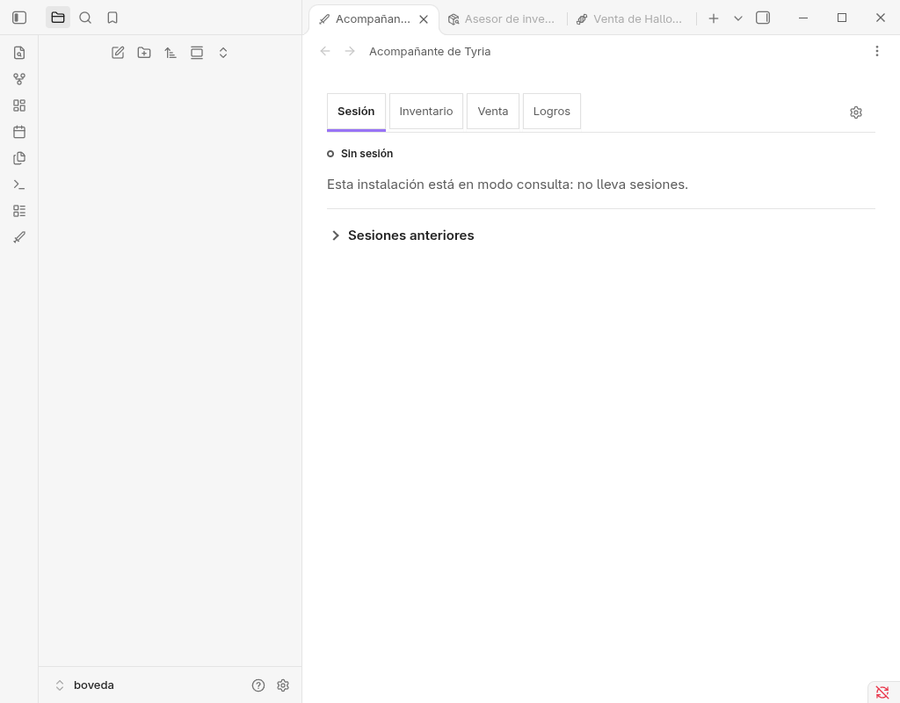

# Obsidian desechable (AppImage), 11 oct 2026: RT-03, RT-15 y RT-17 con la 0.6.45

Máquina: Fedora 44 (Linux 7.2.9-200.fc44.x86_64), Node v22.23.1. Código leído: `origin/main` =
`4f5136c4b4a1` (tras `git fetch`, árbol limpio, sin commits propios). Release medida: la GitHub Release
`0.6.45` publicada. Los scripts del repo se ejecutaron desde una copia `git archive origin/main` fuera
del repo; no se instaló nada en el repo y `git status --porcelain` siguió vacío.

Este documento repite, con el aislamiento que faltó, la medición parcial de
[`2026-10-10-obsidian-desechable.md`](2026-10-10-obsidian-desechable.md) (flatpak, detenida por
sustituir el socket del CLI de David).

Marcas: MEDIDO = observado en la instancia real; LEÍDO = leído en código o documentación;
INFERIDO = deducido, no observado.

## Resultado

| Tarea | Resultado | Clase |
|---|---|---|
| RT-03 carga + reapertura | `verify-beta-runtime` PASS antes y después de cerrar y reabrir; panel, Inventario y Venta abren las dos veces | MEDIDO |
| RT-15 el candado muere con el proceso | Tras `kill -9` y reabrir, `navigator.locks.query()` = `{"held":[],"pending":[]}`: ni `tc-probe` ni el candado viejo del plugin | MEDIDO |
| RT-17 almacén de sesión mudo | `runtimeReady` a los **10,10 s**; con sesión y colector mudos, a los **20,05 s** | MEDIDO |
| RT-17 recuperación al soltar el bloqueo | **HALLAZGO: no se recupera sola**; sigue en «Error de sesión» (166 s según la medición) | MEDIDO |
| Socket del CLI de David | Mismo inodo y misma fecha (`18517`, `1791660523`) en todas las comprobaciones | MEDIDO |

## Cómo se aisló del Obsidian de David

La causa de la parada del 10 oct fue que el servidor de CLI de Obsidian hace `unlinkSync` y `listen`
sobre `join(process.env.XDG_RUNTIME_DIR || homedir(), ".obsidian-cli.sock")` sin mirar el ajuste `cli`
(LEÍDO, en la medición del 10 oct), y dentro de flatpak ese directorio es compartido por todas las
instancias del mismo app-id. Esta vez:

- **AppImage oficial fuera de flatpak** (MEDIDO): Obsidian 1.14.4 AppImage descargado de
  `obsidianmd/obsidian-releases` (v1.14.4), con sha256 igual al digest de GitHub; extraído con
  `--appimage-extract`. CDP: `Chrome/150.0.7871.250`, `Electron/43.7.7`.
- **Entorno propio** (MEDIDO): un script de lanzamiento usa `systemd-run --user --scope -p MemoryMax=3G`
  y `env -i` con `HOME`, `XDG_CONFIG_HOME`, `XDG_CACHE_HOME`, `XDG_DATA_HOME`, `XDG_STATE_HOME` y
  `XDG_RUNTIME_DIR` propios, `WAYLAND_DISPLAY` con ruta absoluta, `DBUS_SESSION_BUS_ADDRESS=disabled:`,
  `--user-data-dir` propio y `--remote-debugging-port=9334`.
- **`XDG_RUNTIME_DIR` por enlace simbólico** (MEDIDO): la ruta real hasta el socket superaba el límite de
  107 caracteres de un socket Unix, así que se usó un enlace corto en el directorio temporal de la
  sesión (ya borrado).
- **CLI real contra la instancia desechable** (MEDIDO): el `obsidian-cli` del AppImage es byte a byte el
  `~/.local/bin/obsidian` de David. Busca el socket en `$XDG_RUNTIME_DIR/.obsidian-cli.sock` y luego en
  `$XDG_RUNTIME_DIR/.flatpak/md.obsidian.Obsidian/xdg-run/.obsidian-cli.sock`; con el `XDG_RUNTIME_DIR`
  propio las dos rutas caen en la carpeta desechable. Un envoltorio del CLI exigía antes que el socket
  propio existiera. El servidor de CLI se activó en la desechable con el mismo IPC que el interruptor
  de Ajustes (`ipcRenderer.sendSync("cli", true)`).
- **Vigilancia del inodo del socket de David** (MEDIDO): un vigilante cada 0,5 s habría matado la
  instancia si el inodo o la fecha del socket cambiaban. Se registró además antes y después de cada
  arranque, cierre y `kill` (línea base, antes y después de run1, run2 y run3, y una final a las 10:08).
  Resultado: siempre `18517 1791660523`, y `/run/user/1000/.obsidian-cli.sock` no se creó nunca. No se
  disparó ninguna alerta.
- **Procesos de David** (MEDIDO): vivos y con la misma hora de inicio (10 oct 12:03:30-32) al terminar.
- **Recursos propios**: bóveda, perfil, `xdg/` y `home/` dentro del directorio temporal de la sesión.

| Comprobación | Antes del primer arranque | Después de cada arranque, cierre y `kill` | Final |
|---|---|---|---|
| Socket de David (inodo, mtime) | `18517 1791660523` | `18517 1791660523` (8 puntos de control) | `18517 1791660523` |
| `/run/user/1000/.obsidian-cli.sock` | no existe | no existe | no existe |

### El socket del CLI de David ya estaba muerto desde el 10 oct

Al empezar, `/run/user/1000/.flatpak/md.obsidian.Obsidian/xdg-run/.obsidian-cli.sock` ya tenía inodo
18517 y mtime 10 oct 21:28:43 (MEDIDO): es **el socket muerto que dejó la instancia desechable flatpak
del 10 oct**, no esta prueba. El Obsidian de David (pid 3999244) sigue escuchando en un socket
desenlazado (`ss -xlp`: inodo 8403455) (MEDIDO). Consecuencia (INFERIDO a partir del mecanismo ya
descrito el 10 oct): el CLI de David y el MCP `obsidian` siguen sin llegar a su instancia hasta que
reinicie Obsidian o desactive y active el CLI en Ajustes. Esta prueba no lo arregla ni lo empeora: se
tomó ese estado como referencia y no cambió.

## RT-03 · Instalación, carga y reapertura: MEDIDO

```
gh release download 0.6.45 -R fodaveg/tyrian-companion -p 'tyrian-companion-0.6.45.zip*'
sha256sum -c tyrian-companion-0.6.45.zip.sha256  -> la suma coincide
node scripts/install-beta.mjs install --vault <bóveda> --archive <zip> --confirm-obsidian-closed
  -> beta channel v1: PASS (installed none -> 0.6.45; files=manifest.json,main.js,styles.css)
```

Los sha256 de `main.js`, `styles.css` y `manifest.json` instalados coinciden con los digests de la release.

**Primera apertura (run1).** La bóveda abre en modo restringido con el modal «¿Confía en el autor de esta
bóveda?». El modal se cerró y el plugin quedó activado a las 09:59:44-45 **sin que el script pulsara
nada**: el clic llegó tarde y no encontró el botón. Lo más probable es que alguien lo pulsara en la
ventana visible del escritorio (INFERIDO). Resultado: `community-plugins.json = ["tyrian-companion"]` y
plugin cargado.

```
verify-beta-runtime --vault <bóveda> --obsidian-cli <envoltorio>
  -> beta runtime v2: PASS (disk=0.6.45; registered=0.6.45; runtime=0.6.45; runtimeReady=true; release-bytes=match)
```

Con los comandos `open-companion`, `open-inventory-advisor` y `open-sale` (capturas del
panel hechas, no copiadas aquí):

- Sesión: «Sin sesión · Esta instalación está en modo consulta: no lleva sesiones · Sesiones anteriores».
- Inventario: «Falta vincular la clave API», «Vincular clave», buscador y filtros, «Sincronizar
  inventario» y «DESACTIVADO · Selecciona una clave API antes de sincronizar».
- Venta: «Falta vincular la clave API … Este dispositivo está en modo consulta: actualiza el inventario
  en el asesor para calcular la venta.»

**Reapertura (run2).** Cierre ordenado con `SIGTERM` al proceso principal (los 7 procesos salen y el
scope desaparece) y relanzamiento con el mismo perfil:

| Medida | Valor |
|---|---|
| `runtimeReady === true` tras el lanzamiento | +0,88 s |
| Modal o modo restringido | ninguno |
| `verify-beta-runtime` | PASS, misma línea que en run1 |
| Vistas restauradas (`tyrian-companion-view`, `tyrian-inventory-advisor-view`, `tyrian-sale-view`) | las tres, con el mismo contenido |

El botón «Reintentar» que aparece en el texto del panel pertenece a una alerta oculta de «Sesiones
anteriores»; no hay error (MEDIDO). Tras RT-17 (run3), `verify-beta-runtime` vuelve a dar PASS.

## RT-15 · El candado muere con el proceso: MEDIDO

```
navigator.locks.request("tc-probe", () => new Promise(() => {}))
navigator.locks.query() -> held: tc-probe + tyrian-companion-lease:wl1:<uuid A>   (mismo clientId)
kill -KILL de los 7 procesos del scope (10:01:41.73); todos muertos, scope eliminado
relanzamiento con el mismo perfil (10:01:54.02)
navigator.locks.query() a +0,58 s del lanzamiento (12,88 s tras el kill) -> {"held":[],"pending":[]}
2 s después -> held: solo tyrian-companion-lease:wl1:<uuid B>  (clientId nuevo)
```

El candado no sobrevive al proceso: en la primera consulta posible tras reabrir ya no está, y el candado
nuevo lleva otro uuid y otro cliente. El hueco de 12,3 s entre el `kill` y el relanzamiento es del script,
no del candado. A un proceso muerto no se le puede consultar, así que no hay una cifra más fina de cuándo
se liberó. El `.obsidian-cli.sock` huérfano que dejó el proceso muerto quedó en la carpeta desechable y
el relanzamiento lo sustituyó sin problema.

## RT-17 · Almacén de sesión mudo: MEDIDO, con HALLAZGO

Base de sesión: `tyrian-companion-session-runtime:<vault>` v2. Cómo se silenció (script por CDP en la
misma página): `indexedDB.open(nombre, 3)`; su `upgradeneeded` llega al momento, sin `blocked`, y la
transacción de versión se mantiene viva encadenando `store.count()` desde `onsuccess` (unas 30 000
peticiones por segundo). Mientras tanto, las aperturas del plugin quedan en cola. Después otro script
hace `disablePlugin` → `enablePlugin` y sondea `core.runtimeReady` cada 50 ms.

| Escenario | `enablePlugin` resuelve | Panel abierto | `runtimeReady` | Avisos (`.notice`) |
|---|---|---|---|---|
| Almacén de sesión mudo | 49 ms | 65 ms | **10,10 s** (10 103 ms de reloj de página) | ninguno |
| Sesión y `tyrian-companion-collector` mudos a la vez | (no desglosado) | 52 ms | **20,05 s** (20 053 ms) | ninguno |
| Control, sin bloqueo | 42 ms | 59 ms | 100 ms | n/a |

- **10,10 s** coincide con `STORAGE_ANSWER_TIMEOUT_MS = 10_000` (LEÍDO, `storage-deadline.ts`).
- **20,05 s** es el peor caso que documenta ESTADO: 10 s del modo de colector y 10 s de la sesión
  (LEÍDO).
- El usuario tiene la interfaz antes de `runtimeReady` (el panel abre a los 65 ms).
- Lo que ve: de 0 a 10 s (de 0 a 20 s en la variante), **«Sin sesión · Esta instalación está en modo
  consulta: no lleva sesiones»**, idéntico a un arranque normal y sin indicador de espera. Después,
  **«● Error de sesión»** (punto rojo) junto al mismo texto de «modo consulta». Ningún aviso en todo el
  tiempo. Capturas: 
  
- Inventario y Venta quedan abiertas como pestañas no visitadas, con texto vacío hasta activarlas.

### Hallazgo: el panel no se recupera solo al volver el almacén

Se abortó la transacción que bloqueaba (la base sigue en v2, sin cambios) y se vigiló el panel:

| Tiempo desde soltar el bloqueo | Estado del panel |
|---|---|
| 1, 3, 6, 10, 15, 20, 30, 45, 60, 75, 90 s | «Error de sesión» (registro de vigilancia; en todas, el bloqueo aparece abortado) |
| 95 y 166 s | «Error de sesión» (según el informe de la medición; el registro de vigilancia que se conserva llega a los 90 s) |

ESTADO (0.6.24, lote 1) dice «se recupera solo cuando el almacén vuelve» (LEÍDO). En un equipo en modo
`consult`, sin sesión, no ocurrió en casi 3 minutos. Que el reintento por latido solo corra con una sesión
o en modo `collector` es una hipótesis (INFERIDO, no leída en el código). La salida que tiene hoy el
usuario es desactivar y activar el plugin: el control sin bloqueo da `runtimeReady` en 100 ms y vuelve a
«Sin sesión» (MEDIDO). **El arreglo va en otra rama.**

Sobre «la 0.6.36 dice listo a los 10 s» (LEÍDO): el «10 s en vez de 20» de ESTADO §0.6.36 es el arranque
de **Hebra** con almacén mudo. En Obsidian lo medido es 10 s con solo la sesión muda y 20 s con sesión y
colector mudos.

Al final se abortaron los bloqueos y se recargó el plugin: todas las bases quedaron en su versión
original (sesión v2, colector v1) y `verify-beta-runtime` dio PASS (MEDIDO).

## Qué no se midió

- Un cliente BRAT real instalando desde la lista de BRAT: se instaló con `scripts/install-beta.mjs` desde
  el zip de la release, no a través de BRAT.
- Modo restringido pulsado por el script: el modal lo cerró alguien en la ventana visible (INFERIDO), así
  que el clic exacto de «Confiar» no está medido.
- Nada con Obsidian en macOS, Windows o móvil; nada con Hebra (fuera de este documento).
- RT-17 en modo `collector` o con una sesión viva: solo se midió una instalación en `consult` sin sesión.
  Por eso no se sabe si el reintento por latido recupera el estado en esos modos.
- Mudez de otros almacenes distintos de sesión y colector.
- RT-15 con un cierre del sistema o un fallo del equipo; solo `kill -KILL` de los procesos del scope.
- Una cifra más fina que 12,88 s para la liberación del candado.
- Recuperación a más de 166 s.

## Comandos y logs

- Scripts propios en el directorio temporal de la sesión (no se enlazan porque son temporales): lanzador
  (`systemd-run` + `env -i`), terminador (solo PIDs del cgroup del scope propio), vigilante del socket,
  envoltorio del CLI, cliente CDP (`eval` y captura contra el puerto 9334) y tres scripts de RT-17
  (bloqueo, bloqueo múltiple y `disablePlugin`/`enablePlugin` con sondeo).
- Logs: instalación, `verify-beta-runtime` de run1, run2 y final, salida de Obsidian de las tres
  ejecuciones, PIDs, `kills`, vigilancia del socket, RT-15 antes y después, y las líneas de tiempo de
  RT-17. Se citan los valores arriba.

## Limpieza

Procesos propios muertos (run1 con `SIGTERM`, run2 con `kill -9`, run3 con `SIGTERM`), comprobado con
`kill -0` y sin scopes `tco-*`. Borrados: AppImage y su extracción (479 MB), bóveda, perfil, `xdg/`,
`home/`, la copia del repo, los assets sueltos y el enlace del `XDG_RUNTIME_DIR`. `/tmp` (tmpfs): 8,9 GiB
libres antes de limpiar y 9,4 GiB después.
